# High-Level Architecture: Kubernetes Terminal Audit to AWS CloudWatch

A presentation-ready, high-level architecture diagram showing the **Kubernetes Cluster**, **Nodes**, **Pods**, **DaemonSets**, and the **Log Flow to AWS CloudWatch**.

---

## Architecture Diagram

```mermaid
graph LR
    %% External Users & CloudWatch
    subgraph Users["👥 Users & Consumers"]
        DevUser["🧑‍💻 DevOps / Engineer<br/><b>ArgoCD Web Terminal</b>"]
        SecUser["🛡️ Security Team / SIEM<br/><b>CloudWatch Insights</b>"]
    end

    %% Kubernetes Cluster
    subgraph K8sCluster["☸️ Kubernetes Cluster (Amazon EKS / Minikube)"]
        
        %% ArgoCD Control Plane
        subgraph ArgoNamespace["Namespace: argocd"]
            ArgoServer["🚀 <b>ArgoCD Server</b><br/>Web Terminal Controller"]
        end

        %% Kubernetes Worker Node
        subgraph WorkerNode["🖥️ Kubernetes Worker Node (Linux OS)"]
            
            %% Application Pod
            subgraph AppNamespace["Namespace: nodejs-app"]
                AppPod["📦 <b>Application Pod</b><br/>nodejs-hello-world<br/><i>(User executes: ls, cat, rm)</i>"]
            end

            %% Linux Kernel eBPF
            subgraph KernelLayer["🐧 Linux Kernel (eBPF)"]
                eBPFProbe["⚡ <b>eBPF Probes</b><br/>sys_execve & sys_chdir"]
            end

            %% DaemonSets in kube-system
            subgraph KubeSystem["Namespace: kube-system"]
                TetragonDS["🔍 <b>Tetragon DaemonSet</b><br/>eBPF Audit Engine<br/><i>(Filters nodejs-app only)</i>"]
                FluentBitDS["📡 <b>AWS Fluent Bit DaemonSet</b><br/>Log Shipper & Lua Formatter"]
            end

            NodeLogs[("📄 <b>Node Host Logs</b><br/>/var/log/pods/...")]
        end
    end

    %% AWS CloudWatch / LocalStack
    subgraph AWSCloud["☁️ AWS Cloud (or LocalStack)"]
        CWLogs["📊 <b>Amazon CloudWatch Logs</b><br/><code>/aws/eks/audit/terminal-commands</code><br/><i>[Session: id] pod -> cmd</i>"]
    end

    %% Connections / Log Flow
    DevUser ==>|"1. Open Terminal & Run Commands"| ArgoServer
    ArgoServer ==>|"2. pods/exec"| AppPod
    AppPod -.->|"3. Kernel Syscall"| eBPFProbe
    eBPFProbe ==>|"4. Intercept Execution"| TetragonDS
    TetragonDS ==>|"5. Stream JSON Events"| NodeLogs
    NodeLogs ==>|"6. Tail & Format [Session] Pod -> Cmd"| FluentBitDS
    FluentBitDS ==>|"7. Secure Push (HTTPS / IRSA)"| CWLogs
    CWLogs ==>|"8. Query, Search, Alarms"| SecUser

    %% Styling for Presentation (AWS / K8s Theme)
    classDef userStyle fill:#2563EB,stroke:#1D4ED8,color:#FFFFFF,stroke-width:2px;
    classDef argoStyle fill:#F97316,stroke:#EA580C,color:#FFFFFF,stroke-width:2px;
    classDef appStyle fill:#10B981,stroke:#059669,color:#FFFFFF,stroke-width:2px;
    classDef kernelStyle fill:#374151,stroke:#1F2937,color:#FFFFFF,stroke-width:2px;
    classDef daemonStyle fill:#8B5CF6,stroke:#7C3AED,color:#FFFFFF,stroke-width:2px;
    classDef logStyle fill:#F59E0B,stroke:#D97706,color:#FFFFFF,stroke-width:2px;
    classDef awsStyle fill:#0284C7,stroke:#0369A1,color:#FFFFFF,stroke-width:2px;

    class DevUser,SecUser userStyle;
    class ArgoServer argoStyle;
    class AppPod appStyle;
    class eBPFProbe kernelStyle;
    class TetragonDS,FluentBitDS daemonStyle;
    class NodeLogs logStyle;
    class CWLogs awsStyle;
```



---

## 8-Step High-Level Flow Summary

```
[1. User] ───────────────► Opens Web Terminal on ArgoCD UI (https://127.0.0.1:8080)
   │
[2. ArgoCD Server] ──────► Connects to Application Pod (nodejs-hello-world) via pods/exec
   │
[3. Application Pod] ────► User runs terminal commands (ls, cat, whoami, rm)
   │
[4. Linux Kernel eBPF] ──► eBPF hooks (sys_execve) instantly catch executed commands
   │
[5. Tetragon DaemonSet] ─► Filters background noise and writes audit logs to node storage
   │
[6. Node Host Storage] ──► Host log file (/var/log/pods/kube-system_tetragon*/.../0.log)
   │
[7. AWS Fluent Bit] ─────► Tails logs, applies Lua format: [Session: id] pod -> command
   │
[8. AWS CloudWatch] ─────► Stored in /aws/eks/audit/terminal-commands for Security & SIEM
```

---

## Key Elements & Roles

| Icon / Element | Name | Type | Purpose |
| :---: | :--- | :--- | :--- |
| 🧑‍💻 | **DevOps / Engineer** | User | Accesses the pod terminal via ArgoCD UI without needing direct SSH or Kubeconfig. |
| 🚀 | **ArgoCD Server** | Control Plane Pod | Authenticates users, enforces RBAC, and proxies the interactive terminal session. |
| 📦 | **Node.js Hello World** | Application Pod | The audited workload container running in `nodejs-app` namespace. |
| 🐧 | **Linux Kernel (eBPF)** | OS Kernel | Non-bypassable kernel probes intercepting every `execve` and `chdir` syscall. |
| 🔍 | **Cilium Tetragon** | DaemonSet (1 per Node) | eBPF engine that captures kernel events and applies namespace filtering. |
| 📡 | **AWS Fluent Bit** | DaemonSet (1 per Node) | Official AWS log shipper that formats session lines and pushes to CloudWatch. |
| 📊 | **Amazon CloudWatch** | AWS Managed Service | Centralized log group for long-term audit storage, retention, and security alarms. |

---

## Required Resources & Their Purpose

Here is the complete inventory of all resources required to implement, operate, and secure this terminal audit logging solution:

### 1. Kubernetes In-Cluster Resources

| Resource Kind | Name / Namespace | Purpose |
| :--- | :--- | :--- |
| **DaemonSet** | `tetragon`<br/>*(kube-system)* | Runs one pod per worker node with privileged eBPF capabilities (`bpf`, `sys_admin`, `perfmon`). Injects kernel probes directly into the host Linux kernel to intercept all process executions. |
| **CustomResourceDefinition & Custom Resource** | `TracingPolicy: terminal-command-audit`<br/>*(Cluster-scoped)* | Instructs Tetragon which kernel tracepoints to attach to (`sys_execve` and `sys_chdir`). Targets only specific application labels (e.g., `app: nodejs-hello-world`) and filters out normal runtime noise (e.g., node server startup). |
| **DaemonSet** | `aws-fluent-bit`<br/>*(kube-system)* | Official AWS log forwarding agent deployed on every worker node. Tails Tetragon JSON log files from the host node filesystem, executes in-flight Lua parsing/formatting, and pushes log streams directly to CloudWatch Logs. |
| **ConfigMap** | `aws-fluent-bit-config`<br/>*(kube-system)* | Stores the Fluent Bit operational pipelines: Input Tail configuration, Docker container log parser, inline Lua transformation script (`format_audit.lua`), and the CloudWatch output plugin configuration. |
| **ServiceAccount** | `aws-fluent-bit`<br/>*(kube-system)* | Provides pod identity within Kubernetes. In production AWS EKS, this ServiceAccount is annotated with the IAM Role ARN for **IRSA** (IAM Roles for Service Accounts) so credentials rotate automatically without API keys. |
| **ClusterRole & ClusterRoleBinding** | `aws-fluent-bit-role`<br/>`aws-fluent-bit-binding` | Grants Fluent Bit read-only permissions (`get`, `list`, `watch`) on Kubernetes `pods` and `namespaces` to enrich log records with pod metadata. |
| **HostPath Volumes** | `/var/log`<br/>`/var/lib/docker/containers` | Mounted into Fluent Bit and Tetragon containers so they can tail stdout/stderr container logs generated by the container runtime (CRI-O / containerd / Docker). |
| **Local SQLite State DB** | `/tmp/flb_tetragon.db`<br/>*(Fluent Bit container)* | Persistent offset tracking database ensuring Fluent Bit resumes exactly where it left off across pod restarts without missing or duplicating log entries. |

---

### 2. AWS Cloud Resources (Production AWS EKS)

| AWS Service / Resource | Resource Identifier | Purpose |
| :--- | :--- | :--- |
| **Amazon CloudWatch Log Group** | `/aws/eks/audit/terminal-commands` | Centralized, durable destination for all terminal audit logs. Configured with retention policies (e.g., 90 days, 365 days) and KMS encryption for compliance (SOC2, PCI-DSS, ISO 27001). |
| **Amazon CloudWatch Log Streams** | `audit-tetragon.audit`<br/>*(or `{node-name}-{pod-name}`)* | Individual streams inside the Log Group grouping log events by node or session for efficient real-time indexing and searching. |
| **AWS IAM Role for Service Accounts (IRSA)** | `arn:aws:iam::<ACCOUNT_ID>:role/EKS-FluentBit-CloudWatchRole` | An AWS IAM role configured with an OIDC trust policy tied to the EKS cluster's OpenID Connect provider. Allows the `aws-fluent-bit` pod to assume AWS credentials securely without static access keys. |
| **AWS IAM Policy** | `arn:aws:iam::<ACCOUNT_ID>:policy/CloudWatchTerminalAuditPolicy` | Restricts Fluent Bit permissions strictly to the audit log group: `logs:CreateLogGroup`, `logs:CreateLogStream`, `logs:PutLogEvents`, and `logs:DescribeLogStreams`. |
| **AWS KMS Key (Optional / Recommended)** | `alias/aws/eks/terminal-audit-key` | Customer Managed Key (CMK) providing envelope encryption for audit records stored at rest in CloudWatch. |
| **CloudWatch Metric Filters & Alarms (Optional)** | `SecurityAlert-DestructiveCommands`<br/>`SecurityAlert-PrivilegeEscalation` | Scans incoming audit streams in real time for high-risk commands (e.g. `rm -rf`, `chmod 777`, `sudo`, `curl | sh`) and triggers instant alerts via **Amazon SNS** to security teams. |

---

### 3. Local Development / Verification Resources (LocalStack)

| Resource Kind | Name / Namespace | Purpose |
| :--- | :--- | :--- |
| **Deployment & Service** | `localstack`<br/>*(localstack namespace)* | Lightweight container providing a mock AWS CloudWatch Logs API locally on port `4566`. Enables 100% offline development, testing, and CI/CD validation without requiring real AWS accounts or incurring cloud costs. |
